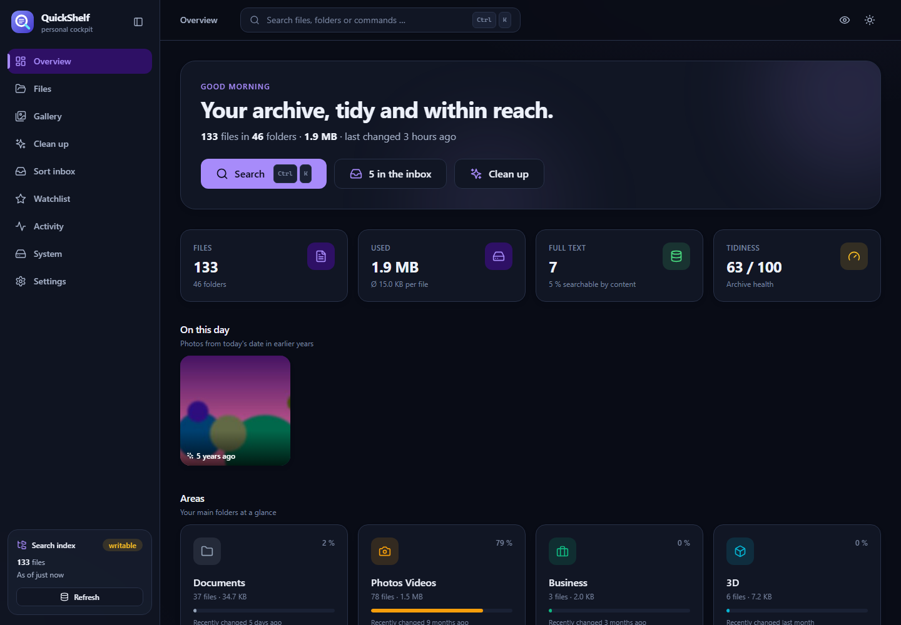
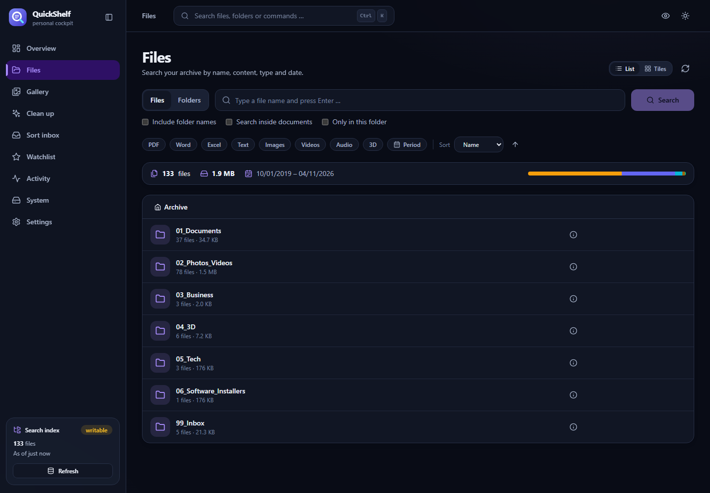
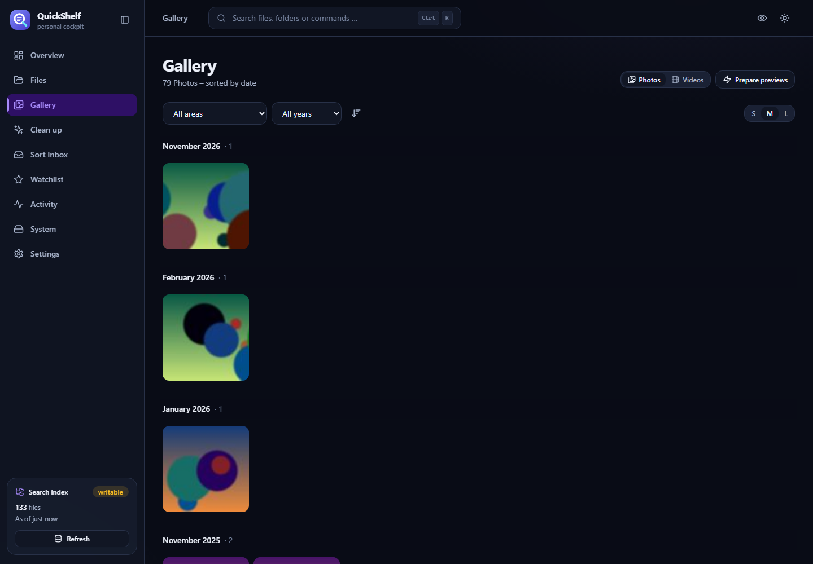
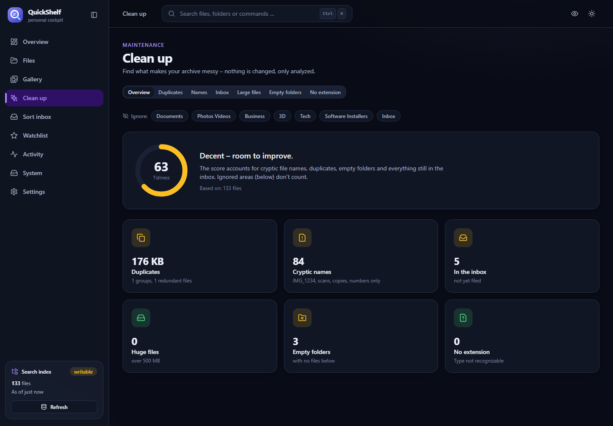
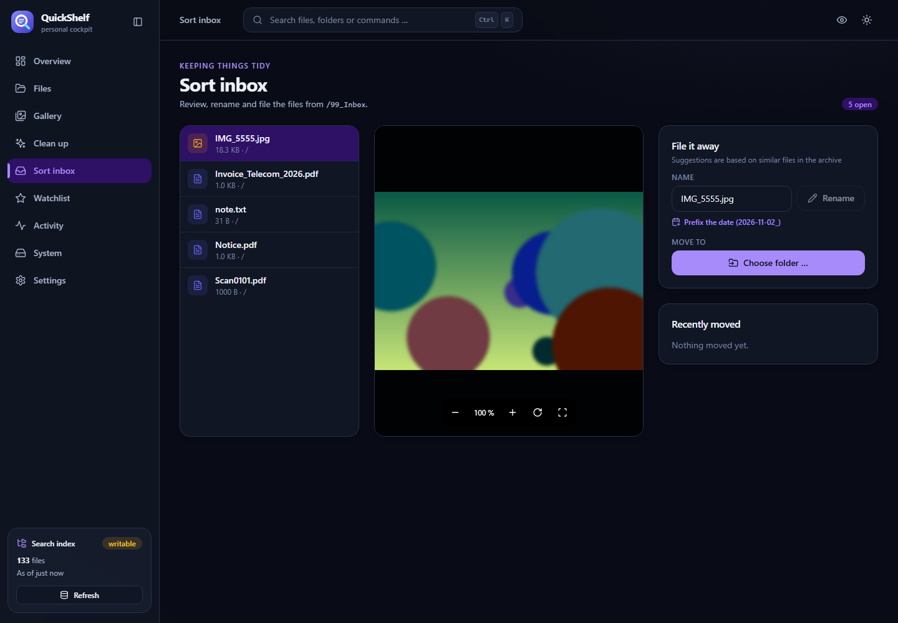

[English](README.md) · **Deutsch**

<p align="center"></p>

# QuickShelf – dein persönliches Dokumenten- & Medienarchiv

Ein schnelles, schönes Cockpit für einen Ordner voller Dokumente, Fotos und Videos – auf **jedem Webspace mit PHP**, ohne Docker und ohne Datenbankserver.
Es liest den Ordnerbaum, baut einen SQLite-Suchindex und macht daraus: Übersicht, Dateisuche (auch im Inhalt), Galerie, Aufräum-Assistent,
Aktivitätskalender, Merkliste mit Tags/Notizen und optional einen Einsortier-Assistenten.

> **Sicher by default:** Login mit Passwort, das Archiv bleibt **nur lesend**, solange du nichts anderes einschaltest.
> Persönliche Daten (Favoriten, Tags, Notizen) liegen in einer eigenen SQLite-Datei **neben** dem Archiv – nie darin.

## Screenshots

<p>
  
  
  
  
  
</p>

## In 5 Minuten loslegen

1. **Release holen:** `quickshelf-<version>.zip` von der Releases-Seite laden (oder selbst bauen: `npm install && npm run release`, Ergebnis in `release/archiv/`).
2. **Hochladen:** Den Inhalt auf deinen Webspace kopieren, z. B. in einen Ordner `archiv/` deines NAS-Webservers.
   Wichtig: PHP ≥ 8.0 mit `pdo_sqlite` und `mbstring` (optional `gd`, `zip`, `exif` für Vorschaubilder, ZIP-Export und Foto-Drehung).
3. **Prüfen (optional, empfohlen):** `http://dein-nas/archiv/check.php` öffnen – zeigt, ob PHP und Ordnerrechte passen und was zu tun ist.
4. **Öffnen:** `http://dein-nas/archiv/` – der Einrichtungsassistent fragt nach Archivordner, Passwort und ob das Cockpit Dateien ändern darf. Fertig.

Der Assistent speichert seine Einstellungen in `api/data/`. Wer lieber per Datei konfiguriert, kopiert `api/.env.example` nach `api/.env`.

### Synology (Web Station)
Paketzentrum → **Web Station** und **PHP 8.x** installieren → in Web Station ein Webportal mit PHP-Profil anlegen →
den Release-Inhalt nach `/volume1/web/archiv/` kopieren. Den Archivordner gibst du im Assistenten als `/volume1/...` an.
Dem Webserver-Benutzer (`http`) braucht `api/data` Schreibrechte und der Archivordner Leserechte.

### QNAP, Apache, Shared Hosting
Inhalt in das Webverzeichnis (`Qweb/archiv`, `htdocs/archiv`, `public_html/archiv` …) kopieren. Die mitgelieferten `.htaccess`-Dateien sperren
Code und Daten automatisch – dafür muss `AllowOverride All` (bzw. mindestens `FileInfo` und `Limit`) aktiv sein.

### nginx + PHP-FPM
nginx liest keine `.htaccess`. Ergänze in deinem `server`-Block (Pfad anpassen):

```nginx
location ^~ /archiv/api/ {
    location ~ ^/archiv/api/(data|config|controllers|core|services|utils|ocr)/ { return 403; }
    location ~ /\. { return 403; }
    try_files $uri /archiv/api/index.php?$query_string;
    location ~ \.php$ { include fastcgi_params; fastcgi_param SCRIPT_FILENAME $document_root$fastcgi_script_name; fastcgi_pass unix:/run/php/php-fpm.sock; }
}
```

Das Cockpit prüft nach dem Login selbst, ob `api/data` öffentlich erreichbar wäre, und warnt dann deutlich.

### Nur ausprobieren (ohne Webserver)
```bash
cd archiv && php -S 127.0.0.1:8080 serve.php
```
Dann `http://127.0.0.1:8080` öffnen. Der eingebaute PHP-Server ist nur zum Testen gedacht (eine Anfrage nach der anderen).

## Sicherheit

- **Login:** Ein Passwort (Hash via `password_hash`), Sitzung per HttpOnly-Cookie bzw. Bearer-Token, 30 Tage gültig. Nach 5 Fehlversuchen wird die Adresse zeitweise gesperrt. Passwortwechsel meldet alle anderen Geräte ab.
- **Beim ersten Aufruf** legt, wer zuerst kommt, das Passwort fest: Richte das Archiv also gleich nach dem Hochladen ein.
- **Internet:** Stelle das Cockpit nur über **HTTPS** (Reverse-Proxy, VPN oder Tunnel) ins Netz. Ohne HTTPS ist selbst ein Passwort im Café-WLAN lesbar.
- **Schreibmodus:** `READ_ONLY=0` erlaubt Verschieben, Umbenennen und Ordneranlage – protokolliert, mit Rückgängig. Löschen gibt es bewusst nicht.
- **Ausblenden:** `EXCLUDE=Tresor,Keys` versteckt Top-Level-Ordner komplett (Liste, Suche, Download, Vorschau).
- `AUTH=0` schaltet den Login ab – nur für ein vertrauenswürdiges Heimnetz.

## Funktionen

| Bereich | Was es kann |
|---|---|
| **Übersicht** | Kennzahlen, Bereichskacheln, Typ-Verteilung, Dateien pro Jahr, Archiv-Gesundheit (0–100), „An diesem Tag“-Fotos, zuletzt geändert / geöffnet |
| **Dateien** | Ordner & Suche (Name, Pfad, Inhalt), Typ- und Datumsfilter, Sortierung, Liste/Kacheln mit Thumbnails, Mehrfachauswahl → **ZIP**, Ordner als ZIP, gespeicherte Suchen, Zustand komplett in der URL |
| **Viewer** | PDF, Bilder (Zoom/Drehen/Pan), Video & Audio (mit Spulen), Word, Excel, Text/CSV; ←/→ blättert, **S** merkt, **I** zeigt Details |
| **Galerie** | Fotos/Videos nach Monaten, endloses Scrollen, Jahr- und Bereichsfilter, Kachelgröße, Vorschaubilder im Voraus erzeugen |
| **Aufräumen** | Archiv-Score, **Dubletten** (mit Hash-Prüfung), kryptische Namen (IMG_1234, Scans, Kopien …), riesige Dateien, leere Ordner, Eingang – mit CSV-Export und **fertigem Prompt für eine KI** |
| **Aktivität** | Kalender-Heatmap (GitHub-Stil), Änderungen pro Tag, neueste Dateien nach Typ |
| **Merkliste** | Favoriten, Tags (`#steuer` in der Suche), Notizen, Verlauf; verschobene Dateien werden per „Neuen Ort suchen“ neu verknüpft |
| **Einsortieren** | Eingang durchgehen, Vorschau, Umbenennen (Datum voranstellen), Verschieben mit Ordnervorschlägen, Ordner anlegen, **Rückgängig** – nur im Schreibmodus |
| **System / Einstellungen** | Speicher, Index, Server-Features; Hell/Dunkel, Akzentfarben, **Diskreter Modus**, Passwort, Tastenkürzel |
| **Überall** | `Strg/⌘ + K` Befehlspalette, responsive (Bottom-Navigation am Handy), tastaturbedienbar, PWA-Manifest |

## Entwicklung

Voraussetzungen: Node ≥ 20, PHP ≥ 8.0 (mit `pdo_sqlite`, `mbstring`; optional `gd`, `zip`, `exif`).

```bash
git clone https://github.com/QuickLinkNet/QuickShelf.git && cd QuickShelf
npm install
npm run dev            # Frontend auf :5173 (proxyt /api -> 127.0.0.1:8081)
powershell scripts/dev-api.ps1   # PHP-API gegen deinen Ordner (nur lesend), Index unter .devdata/
npm run check          # Typecheck + Lint + Vitest + PHP-Tests
npm run release        # -> release/archiv/ (fertig zum Hochladen)
```

Schreibmodus gefahrlos ausprobieren (Wegwerf-Archiv, Port 8082 / 5191):

```bash
python scripts/make_test_archive.py          # pip install pymupdf pillow
powershell scripts/dev-api-write.ps1
npm run dev:write
```

## API (Auszug)

| Endpunkt | Zweck |
|---|---|
| `GET /auth/status` · `POST /auth/{setup,login,logout,password}` | Einrichtung und Anmeldung |
| `GET /list` `/search` `/stat` `/download` | Dateien (Download unterstützt Range → Video-Spulen) |
| `GET /overview` `/folder` `/heatmap` `/day` `/changes` `/memories` | Statistik aus dem Index |
| `GET /insights/{summary,names,large,noext,deep,empty,duplicates}` | Aufräum-Analyse (`skip=` blendet Bereiche aus) |
| `GET /thumb` `/zip` · `POST /thumbs/warm` | Vorschaubilder, ZIP-Export |
| `GET/POST /meta/*` | Favoriten, Tags, Notizen, Verlauf, gespeicherte Suchen, Export |
| `POST /move` `/rename` `/mkdir` `/moves/undo` · `GET /moves` | Schreibmodus – protokolliert, mit Rückgängig |
| `GET /system` · `GET /index/status` · `POST /index/rebuild` | Betrieb |

Alle Endpunkte außer `/auth/*` brauchen eine gültige Sitzung.

## Aufbau

```
src/
  api/          Client + Typen            lib/        reine Funktionen (getestet)
  hooks/        useApi, useFileBrowser …  state/      Auth, Settings, Index, Merkliste, Viewer, Toasts
  components/   atoms · molecules · organisms · templates   (Atomic Design, Dateien < 200 Zeilen)
  pages/        Übersicht, Dateien, Galerie, Aufräumen, Aktivität, Merkliste, Einsortieren, System, Einstellungen, Login, Setup
api/            PHP-API (core · services · controllers · tests)
scripts/        Entwicklungs- und Release-Skripte
```
