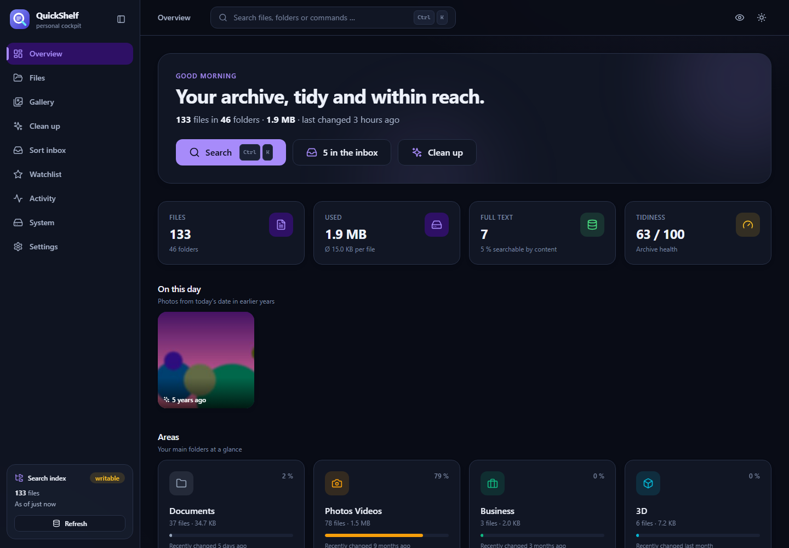
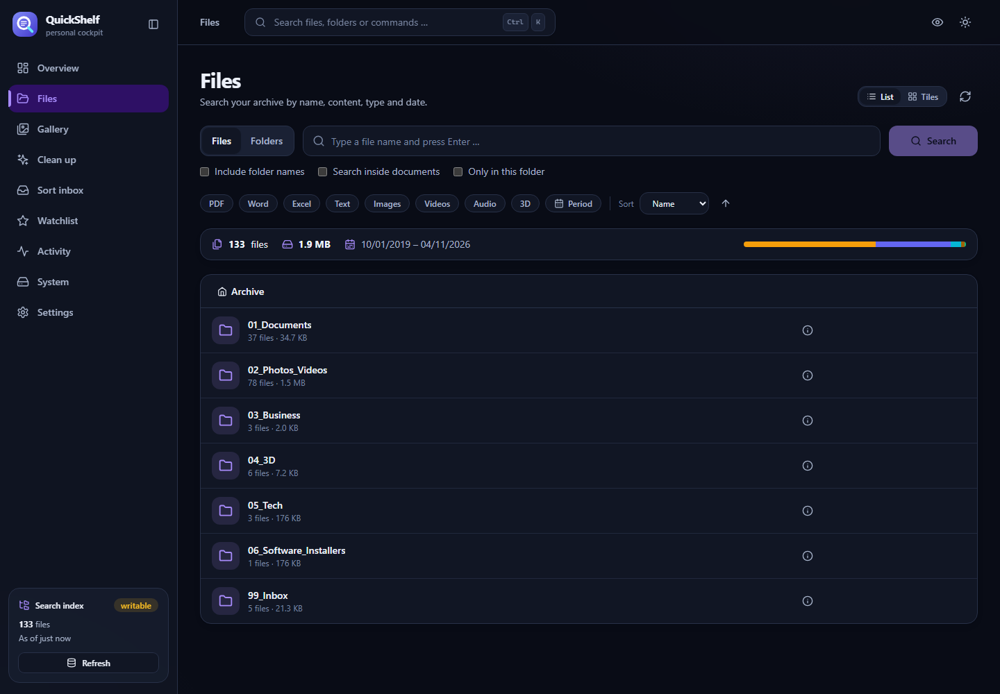
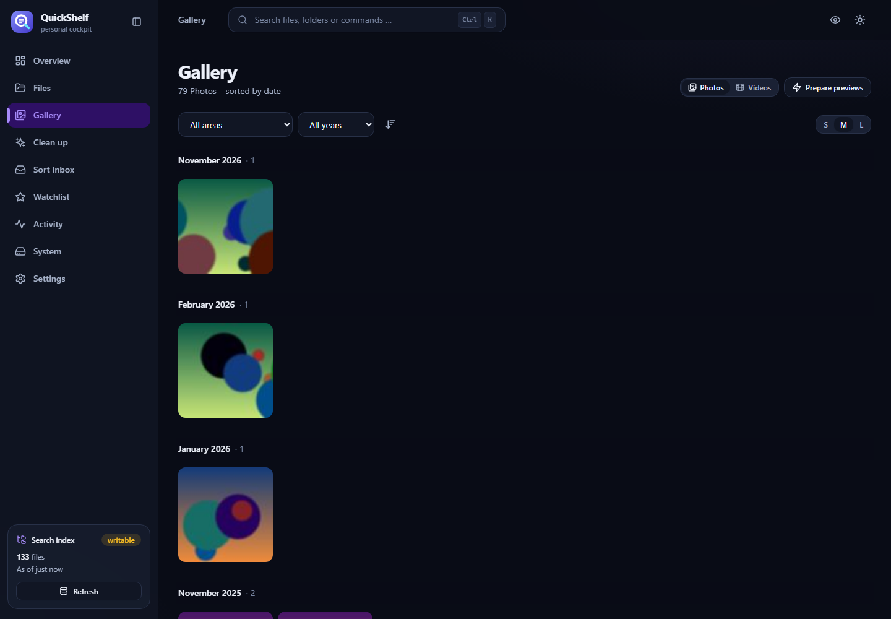
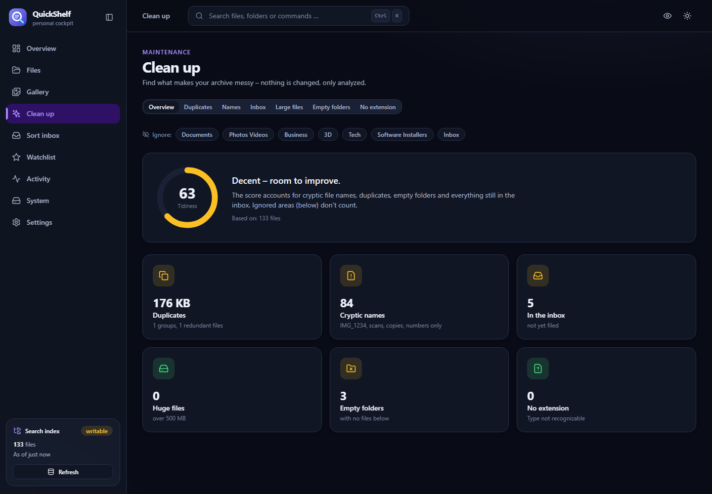
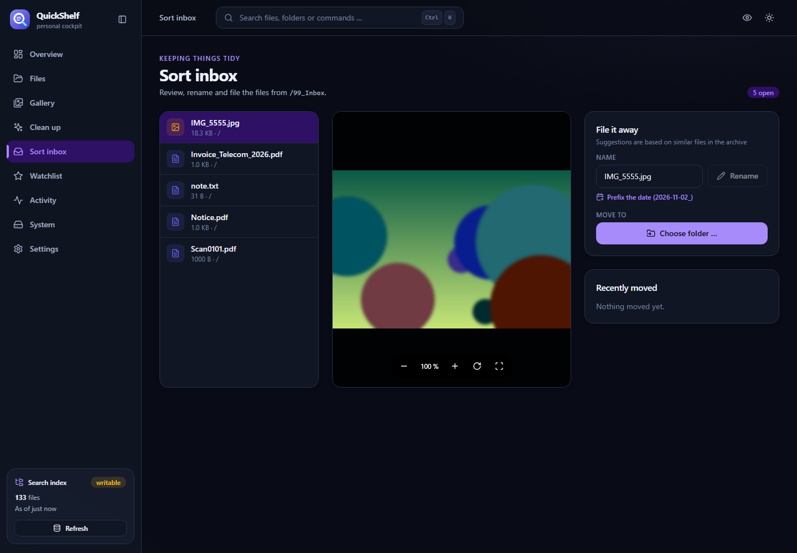

**English** · [Deutsch](README.de.md)

<p align="center"></p>

# QuickShelf – your personal document & media cockpit

A fast, good-looking cockpit for a folder full of documents, photos and videos – on **any web host with PHP**, no Docker and no database server.
It reads your folder tree, builds a SQLite search index and turns it into: overview, file search (including file contents), gallery, clean-up assistant,
activity calendar, a watch list with tags/notes and an optional inbox-sorting assistant. The UI comes in **English and German**.

> **Safe by default:** password login, and the archive stays **read-only** until you switch writing on.
> Personal data (favourites, tags, notes) lives in its own SQLite file **next to** the archive – never inside it.

## Screenshots

<p>
  
  
  
  
  
</p>

## Get started in 5 minutes

1. **Get the release:** download `quickshelf-<version>.zip` from the Releases page (or build it yourself: `npm install && npm run release`, result in `release/archiv/`).
2. **Upload:** copy the contents to your web host, e.g. a folder `archiv/` on your NAS web server.
   Requires PHP ≥ 8.0 with `pdo_sqlite` and `mbstring` (optional `gd`, `zip`, `exif` for thumbnails, ZIP export and photo rotation).
3. **Check (optional but recommended):** open `http://your-nas/archiv/check.php` – it tells you whether PHP and the folder rights are fine and what to fix if not.
4. **Open:** `http://your-nas/archiv/` – the setup wizard asks for the archive folder, a password and whether the cockpit may change files. Done.

The wizard stores its settings in `api/data/`. If you prefer a config file, copy `api/.env.example` to `api/.env`.

### Synology (Web Station)
Package Center → install **Web Station** and **PHP 8.x** → create a web portal with a PHP profile in Web Station →
copy the release contents to `/volume1/web/archiv/`. In the wizard, enter the archive folder as `/volume1/...`.
The web-server user (`http`) needs write access to `api/data` and read access to the archive folder.

### QNAP, Apache, shared hosting
Copy the contents into the web directory (`Qweb/archiv`, `htdocs/archiv`, `public_html/archiv` …). The bundled `.htaccess` files block
code and data automatically – this needs `AllowOverride All` (at least `FileInfo` and `Limit`).

### nginx + PHP-FPM
nginx ignores `.htaccess`. Add this to your `server` block (adjust the path):

```nginx
location ^~ /archiv/api/ {
    location ~ ^/archiv/api/(data|config|controllers|core|services|utils|ocr)/ { return 403; }
    location ~ /\. { return 403; }
    try_files $uri /archiv/api/index.php?$query_string;
    location ~ \.php$ { include fastcgi_params; fastcgi_param SCRIPT_FILENAME $document_root$fastcgi_script_name; fastcgi_pass unix:/run/php/php-fpm.sock; }
}
```

After login the cockpit checks by itself whether `api/data` is publicly reachable and warns you clearly if it is.

### Just try it (no web server)
```bash
cd archiv && php -S 127.0.0.1:8080 serve.php
```
Then open `http://127.0.0.1:8080`. PHP's built-in server is for testing only (one request at a time).

### Try it with a demo archive
```bash
pip install pymupdf pillow
npm install
npm run demo
```
Generates a small made-up archive (no personal data), starts the API and the UI on `http://localhost:5200` – login off, writing on, throw-away data.

## Security

- **Login:** one password (hashed with `password_hash`), session via HttpOnly cookie or bearer token, valid 30 days. After 5 failed attempts the address is locked for a while. Changing the password signs out all other devices.
- **First visit:** whoever opens it first sets the password – so set up the archive right after uploading.
- **Internet:** expose the cockpit only over **HTTPS** (reverse proxy, VPN or tunnel). Without HTTPS even a password can be read on café Wi-Fi.
- **Write mode:** `READ_ONLY=0` allows move, rename and create-folder – logged, with undo. There is deliberately no delete.
- **Hiding:** `EXCLUDE=Vault,Keys` hides top-level folders completely (list, search, download, preview).
- `AUTH=0` turns the login off – only for a trusted home network.

Found a vulnerability? See [SECURITY.md](SECURITY.md).

## Features

| Area | What it does |
|---|---|
| **Overview** | Key figures, area tiles, type distribution, files per year, archive health (0–100), "on this day" photos, recently changed / opened |
| **Files** | Folders & search (name, path, content), type and date filters, sorting, list/tiles with thumbnails, multi-select → **ZIP**, folder as ZIP, saved searches, full state in the URL |
| **Viewer** | PDF, images (zoom/rotate/pan), video & audio (seekable), Word, Excel, text/CSV; ←/→ to browse, **S** to save, **I** for details |
| **Gallery** | Photos/videos by month, infinite scroll, year and area filter, tile size, pre-generate thumbnails |
| **Clean up** | Archive score, **duplicates** (hash-verified), cryptic names (IMG_1234, scans, copies …), huge files, empty folders, inbox – with CSV export and a **ready-made prompt for an AI** |
| **Activity** | Calendar heatmap (GitHub style), changes per day, newest files by type |
| **Watch list** | Favourites, tags (`#tax` in search), notes, history; moved files are re-linked via "find new location" |
| **Sort inbox** | Walk through the inbox, preview, rename (prefix date), move with folder suggestions, create folders, **undo** – write mode only |
| **System / Settings** | Storage, index, server features; light/dark, accent colours, **discreet mode**, password, shortcuts |
| **Everywhere** | `Ctrl/⌘ + K` command palette, responsive (bottom navigation on phones), keyboard friendly, PWA manifest |

## Development

Requirements: Node ≥ 20, PHP ≥ 8.0 (with `pdo_sqlite`, `mbstring`; optional `gd`, `zip`, `exif`).

```bash
git clone https://github.com/QuickLinkNet/QuickShelf.git && cd QuickShelf
npm install
npm run dev            # frontend on :5173 (proxies /api -> 127.0.0.1:8081)
npm run check          # typecheck + lint + Vitest + i18n check + PHP tests
npm run release        # -> release/archiv/ (ready to upload)
```

Translations: German source text is the key; add the English text in `src/i18n/en.ts`. `npm run i18n:check` fails on missing entries.

## API (excerpt)

| Endpoint | Purpose |
|---|---|
| `GET /auth/status` · `POST /auth/{setup,login,logout,password}` | Setup and sign-in |
| `GET /list` `/search` `/stat` `/download` | Files (download supports Range → video seeking) |
| `GET /overview` `/folder` `/heatmap` `/day` `/changes` `/memories` | Statistics from the index |
| `GET /insights/{summary,names,large,noext,deep,empty,duplicates}` | Clean-up analysis (`skip=` hides areas) |
| `GET /thumb` `/zip` · `POST /thumbs/warm` | Thumbnails, ZIP export |
| `GET/POST /meta/*` | Favourites, tags, notes, history, saved searches, export |
| `POST /move` `/rename` `/mkdir` `/moves/undo` · `GET /moves` | Write mode – logged, with undo |
| `GET /system` · `GET /index/status` · `POST /index/rebuild` | Operations |

All endpoints except `/auth/*` need a valid session.

## Layout

```
src/
  api/          client + types            lib/        pure functions (tested)
  hooks/        useApi, useFileBrowser …  state/      auth, settings, index, watch list, viewer, toasts
  components/   atoms · molecules · organisms · templates   (Atomic Design, files < 200 lines)
  pages/        Overview, Files, Gallery, Clean up, Activity, Watch list, Sort inbox, System, Settings, Login, Setup
api/            PHP API (core · services · controllers · tests)
scripts/        development and release scripts
```

## Contributing & licence

Issues and pull requests are welcome – see [CONTRIBUTING.md](CONTRIBUTING.md). Released under the [MIT licence](LICENSE).
